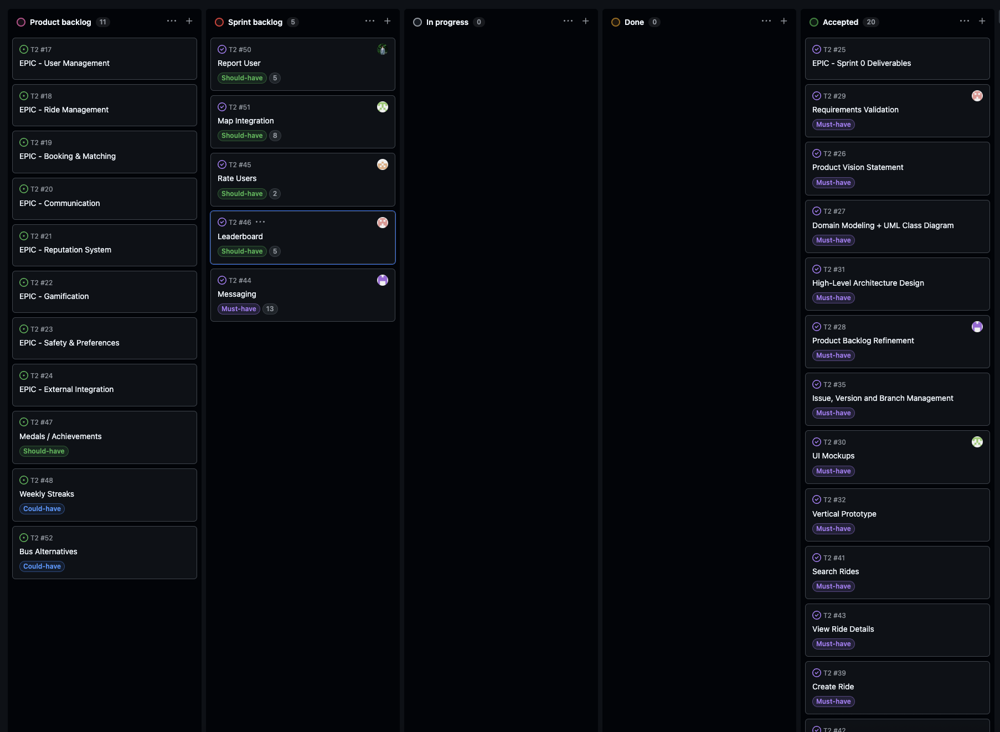
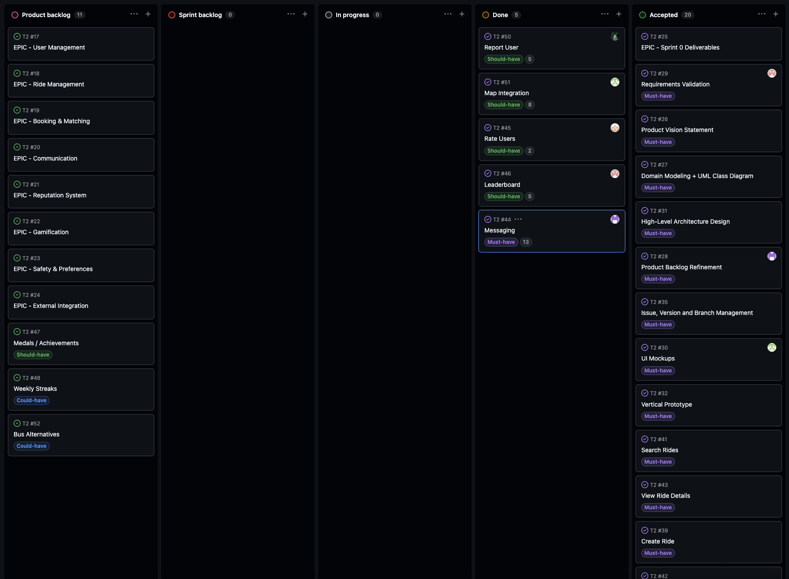
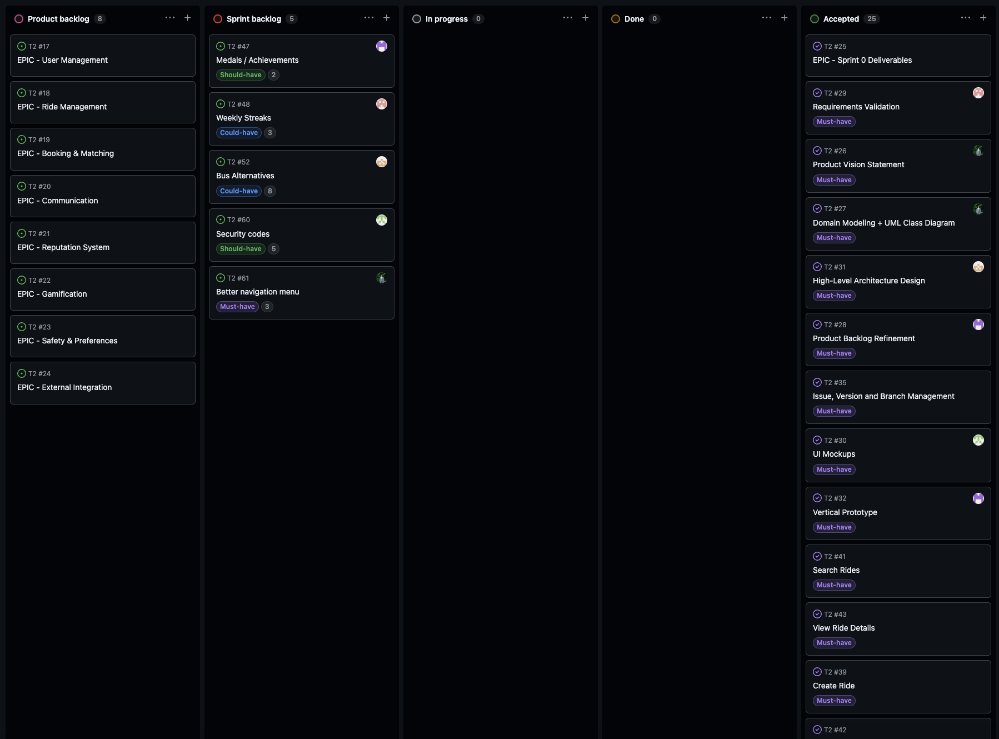
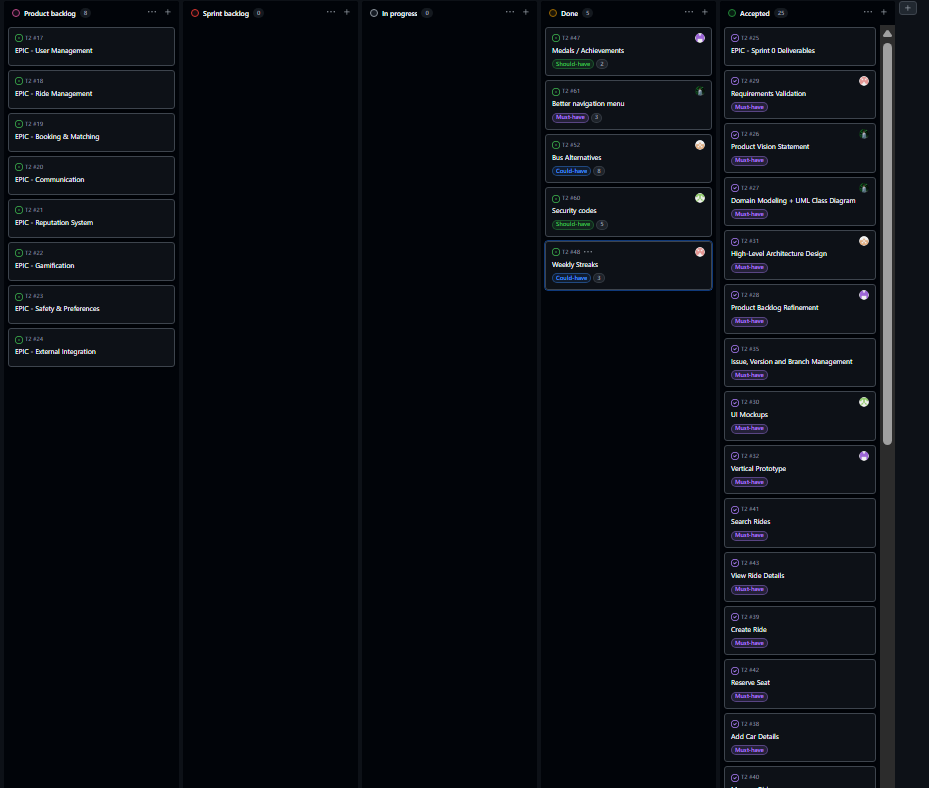

# UniLink Development Report

Welcome to the documentation pages of UniLink!

This Software Development Report, tailored for LEIC-ES-2025-26, provides comprehensive details about UniLink, from high-level vision to low-level implementation decisions. It’s organised by the following activities. 

* [Business modeling](#Business-Modelling) 
  * [Product Vision](#Product-Vision)
  * [Features and Assumptions](#Features-and-Assumptions)
  * [Elevator Pitch](#Elevator-pitch)
* [Requirements](#Requirements)
  * [User stories](#User-stories)
  * [Domain model](#Domain-model)
* [Architecture and Design](#Architecture-And-Design)
  * [Logical architecture](#Logical-Architecture)
  * [Physical architecture](#Physical-Architecture)
  * [Vertical prototype](#Vertical-Prototype)
* [Project management](#Project-Management)
  * [Sprint 0](#Sprint-0)
  * [Sprint 1](#Sprint-1)
  * [Sprint 2](#Sprint-2)
  * [Sprint 3](#Sprint-3)
  * [Sprint 4](#Sprint-4)
  * [Final Release](#Final-Release)
* [How to Run the Project](#How-to-Run-the-Project)
  

Contributions are expected to be made exclusively by the initial team, but we may open them to the community, after the course, in all areas and topics: requirements, technologies, development, experimentation, testing, etc.

Please contact us!

Thank you!

* António Machado up202404630@up.pt
* Diogo Caleiro up202407548@up.pt
* Gonçalo Queirós up202407377@up.pt
* José Lopes up202406360@up.pt
* José Silva up202406359@up.pt

---
## Business Modelling

Business modeling in software development involves defining the product's vision, understanding market needs, aligning features with user expectations, and setting the groundwork for strategic planning and execution.

### Product Vision

UniLink connects university students through safe, free and trusted ride-sharing, making academic mobility simpler, smarter and more social.

### Features and Assumptions

- Request and offer rides with vehicle identification (license plate and car model)
- Passengers can tip drivers
- Leaderboard system
- Only university students can register, using a university-associated email
- User profile including university, course, and academic year
- Average rating and reviews
- Badges (achievements earned as a passenger/driver)
- Google Maps integration
- Weekly streaks
- Bus schedules available when there are not enough rides
- Drivers display the number of rides given on their profile
- Schedule rides in advance
- Book/reserve rides
- Number of available seats
- "Women-only" ride option
- Messaging between driver and passenger
- Reporting system (user/ride reports)

### Elevator Pitch
<!-- 
Draft a small text to help you quickly introduce and describe your product in a short time (lift travel time ~90 seconds) and a few words (~800 characters), a technique usually known as elevator pitch.

Take a look at the following links to learn some techniques:
* [Crafting an Elevator Pitch](https://www.mindtools.com/pages/article/elevator-pitch.htm)
* [The Best Elevator Pitch Examples, Templates, and Tactics - A Guide to Writing an Unforgettable Elevator Speech, by strategypeak.com](https://strategypeak.com/elevator-pitch-examples/)
* [Top 7 Killer Elevator Pitch Examples, by toggl.com](https://blog.toggl.com/elevator-pitch-examples/)
-->

## Requirements

### User Stories

🚶 Passengers

**1. View Ride Details**
> *As a passenger, I want to view ride details so that I can evaluate safety.*

**Acceptance Criteria:**
- Driver information is displayed
- Car details are visible
- Available seats are shown
- Ride route is visible

**2. Search Rides**
> *As a passenger, I want to search rides so that I can find transport.*

**Acceptance Criteria:**
- User can search by origin and destination
- User can filter by date
- Only rides with available seats are shown
- Results are displayed in a list

**3. Reserve a Seat**
> *As a passenger, I want to reserve a seat so that I can join a ride.*

**Acceptance Criteria:**
- User can select a ride
- User can reserve a seat
- Available seats decrease after reservation
- Cannot reserve if ride is full
- Confirmation message is displayed

🚗 Drivers

**4. Create a Ride**
> *As a driver, I want to create a ride so that I can offer transportation.*

**Acceptance Criteria:**
- User can input origin and destination
- User can select date and time
- User can define number of seats
- System validates seats > 0
- Ride is created successfully
- Ride appears in search results

**5. Add Car Details**
> *As a driver, I want to add car details so that passengers can identify my vehicle.*

**Acceptance Criteria:**
- User can input license plate
- User can input car model
- Both fields are required
- Car is linked to user profile

**6. Manage Rides**
> *As a driver, I want to manage my rides so that I can edit or cancel them.*

**Acceptance Criteria:**
- Driver can edit ride details
- Driver can cancel a ride
- Changes are saved correctly
- Cancelled rides are no longer visible

👤 General Profile & Safety

**7. Create and Edit Profile**
> *As a user, I want to create and edit my profile so that others can trust me.*

**Acceptance Criteria:**
- User can edit university, course and year
- Profile data is saved successfully
- Profile is visible to other users

**8. Women-Only Rides**
> *As a female user, I want women-only rides so that I feel safer.*

**Acceptance Criteria:**
- Female driver can enable women-only option
- Only female users can reserve
- System enforces restriction


### Domain model

 <p align="center" justify="center">
  
</p>

- **University**: Academic institution associated with users and responsible for validating restricted registration.
- **User**: Registered student who may act as driver, passenger or both.
- **Car**: Vehicle registered by a driver for ride sharing.
- **Ride**: Transportation offer created by a driver.
- **Booking**: Reservation made by a passenger for a specific ride.
- **Review**: Evaluation submitted after a completed ride.
- **Chat**: Communication exchanged between users in the context of a booking.
- **Badge**: Achievement that may be earned through platform activity.
- **UserBadge**: Association between a user and a badge earned.
- **Report**: Complaint submitted by a user regarding another user or a ride.


## Architecture and Design

The **UniLink** system is organized into distinct components to ensure that the user interface, the business logic, and the data storage are well-separated. This organization makes the system easier to develop, test, and maintain as the project grows.

To document our architecture, we decomposed the system into three main parts:

* **The Frontend:** A mobile application that handles all user interactions and displays information.
* **The Backend:** A central server that processes all the rules of the carpooling system, such as managing rides and user accounts.
* **The Persistence Layer:** Responsible for safely storing all the information generated by the users.

In the following sections, we describe how these components interrelate and the specific technologies used to implement each part of the system.


### Logical architecture

<p align="center" justify="center">
  
</p>


### Physical Architecture

<p align="center" justify="center">
  
</p>


The physical structure of the UniLink system is organized into three main hardware nodes:

* **Mobile Device (Node):** Represents the user's smartphone.
    * **UniLink App (Artifact):** The mobile application client developed with React Native/Expo.
* **Application Server (Node):** The central server responsible for the backend logic and data.
    * **UniLink Backend (Artifact):** The server-side application running on Node.js.
    * **Internal Services:** Logical modules for Ride, User, and Gamification management.
    * **MySQL (Database):** The relational database used for persistent data storage (Schema: UniLink_DB).
* **External Services Server (Node):** Third-party servers that provide additional functionality.
    * **Google Maps API:** Used for geolocation and route visualization.
    * **Bus Schedule Service:** Integration with external public transport data.

**Connections:**
* **Mobile Device <-> Application Server:** Standard internet connection for data exchange.
* **Application Server <-> External Services:** Data exchange through external APIs.

## Vertical prototype

The vertical prototype implements the core functionality of UniLink, focusing on the main differentiating feature of the application: safe university ride-sharing with the option for women-only rides.

Implemented features:

- user registration restricted to university context  
- profile management  
- vehicle registration  
- ride creation with origin, destination, date and seats  
- women-only ride option  
- ride search with filters  
- seat reservation and cancellation  
- view created and reserved rides  

This prototype demonstrates the main value of UniLink:
allowing students to coordinate transportation easily and safely within their academic community.

The women-only ride option represents an important safety feature requested during requirements validation.

A functional APK was generated and released for testing purposes. Link for Sprint 0 vertical prototype APK: https://expo.dev/artifacts/eas/oox2WQnwTiu29LCRyGhjN4.apk

---

## How to Run the Project

To run the UniLink project locally, follow these steps:

### 1. Prerequisites

Ensure you have the following installed:
- **Node.js** (LTS version)
- **npm** (comes with Node.js)
- **Expo Go** app on your physical device (available on App Store and Google Play) or an **Android Emulator / iOS Simulator**.
- **Maestro CLI** (optional, for running acceptance tests).

### 2. Installation & Setup

Clone the repository, navigate to the `UniLink` directory, and install the dependencies:

```bash
git clone <repository-url>
cd UniLink
npm install
```

### 3. Running the App

The project comes with the necessary Firebase configuration in the `.env` file already included in the repository. To start the application:

```bash
npm start
```

- **Physical Device**: Scan the QR code displayed in the terminal using the **Expo Go** app (Android) or the **Camera app** (iOS).
- **Android Emulator**: Press `a` in the terminal.
- **iOS Simulator**: Press `i` in the terminal.

### 4. Running Tests

- **Unit Tests**:
  ```bash
  npm test
  ```
- **Acceptance Tests (Maestro)**:
  Make sure your emulator is running and the app is installed, then:
  ```bash
  npm run acceptance:maestro
  ```

---

## Project management
<!--
Software project management is the art and science of planning and leading software projects, in which software projects are planned, implemented, monitored and controlled.

In the context of ESOF, we recommend each team to adopt a set of project management practices and tools capable of registering tasks, assigning tasks to team members, adding estimations to tasks, monitor tasks progress, and therefore being able to track their projects.

Common practices of managing agile software development with Scrum are: backlog management, release management, estimation, Sprint planning, Sprint development, acceptance tests, and Sprint retrospectives.

You can find below information and references related with the project management: 

* Backlog management: Product backlog and Sprint backlog in a [Github Projects board](https://github.com/orgs/FEUP-LEIC-ES-2023-24/projects/64);
* Release management: [v0](#), v1, v2, v3, ...;
* Sprint planning and retrospectives: 
  * plans: screenshots of Github Projects board at begin and end of each Sprint;
  * retrospectives: meeting notes in a document in the repository, addressing the following questions:
    * Did well: things we did well and should continue;
    * Do differently: things we should do differently and how;
    * Puzzles: things we don’t know yet if they are right or wrong… 
    * list of a few improvements to implement next Sprint;

-->

### Sprint 0

#### Sprint goal
Define the foundations of the UniLink project and implement an initial vertical prototype demonstrating the core functionality of the system.

#### Sprint planning

During Sprint 0, the team identified the main problem to address: improving student mobility through a trusted ride-sharing platform restricted to university communities.

The initial product backlog was created and organised into epics and user stories using GitHub Projects. The team prioritised features that represent the core value of the application, such as ride creation, ride search and reservation functionality.

Tasks were divided among team members and estimated in order to ensure balanced workload and incremental progress.

#### Backlog management

The backlog was refined collaboratively to ensure that Product Backlog Items:

- are clearly described  
- provide user value  
- are small enough to be implemented in a short time  
- include acceptance criteria  
- follow INVEST principles  

The backlog includes epics related to:

- ride management  
- user profiles  
- safety features  
- messaging  
- gamification

#### User Survey

A questionnaire was conducted among university students to analyse their mobility habits and evaluate the interest in a ride-sharing platform restricted to the academic community.

The results indicate that students frequently rely on transportation and face limitations in current options. There is a strong interest in a dedicated solution, particularly due to the increased sense of trust within a university environment. Safety, reliability, and ease of use were identified as key factors influencing adoption.

The questionnaire is available at:  
https://docs.google.com/forms/d/1npzmGCK6FxChAs8VoJYxwFdkaKeYml8X504ZGI52Eds

#### Development

The team implemented a vertical prototype focusing on the main functionality of the application:

- register and authenticate users  
- create and manage vehicles  
- create rides  
- search rides with filters  
- reserve and cancel seats  
- women-only ride option  

#### Testing

Unit tests were created for utility functions and filtering logic.

Acceptance tests were implemented using Maestro to simulate real user interaction scenarios such as:

- registering a new user  
- creating rides  
- filtering rides  
- reserving seats  
- cancelling reservations  

#### Continuous Integration

A GitHub Actions workflow was configured to automatically run tests whenever new commits are pushed, ensuring that new changes do not break existing functionality.

#### Sprint retrospective

What went well:

- good team collaboration
- clear division of tasks
- successful implementation of core functionality
- early validation of requirements through survey

What could be improved:

- configuring GitHub Actions workflow earlier
- refine backlog continuously

Next improvements:

- implement messaging system
- add rating and review functionality
- integrate maps API
- improve UI consistency

Link for Sprint 0 vertical prototype APK: https://expo.dev/artifacts/eas/oox2WQnwTiu29LCRyGhjN4.apk

### Sprint 1

### Sprint Backlog

<p align="center" justify="center">
  
</p>

### Done

<p align="center" justify="center">
  
</p>

#### Sprint goal

Extend UniLink with social, safety and navigation features: in-app messaging between ride participants, a rating and reporting system, interactive map view, sustainability leaderboard, and multiple quality-of-life improvements.

#### Sprint planning

Building on the Sprint 0 vertical prototype, the team identified the highest-value features from the backlog:

- **Messaging** — passengers and drivers need a way to communicate before the ride
- **Ratings & Reports** — safety and trust are core to the product vision
- **Map view** — visual discovery of rides improves UX significantly
- **Leaderboard** — gamification drives engagement and reinforces the sustainability angle

Tasks were distributed across team members and tracked in GitHub Projects.

#### Development

Features implemented this sprint:

**🗺️ Map Integration**
- Interactive map view showing all available rides as markers
- Tap a marker to preview route, distance and duration via OSRM
- Polyline route rendering between origin and destination
- User location detection with fallback to FEUP region

**⭐ Rating & Reporting System**
- Passengers can rate drivers after a completed ride
- Drivers can rate passengers
- Report system for inappropriate behaviour during rides
- Only ride participants can submit reviews or reports (enforced in Firestore rules)
- Visual feedback with star ratings and review cards on user profiles

**💬 In-App Messaging**
- Group chat per ride accessible to driver and all passengers
- Chat opens at the most recent message

**🏆 Sustainability Leaderboard**
- Ranks all users by CO₂ saved through ride-sharing
- Top 3 highlighted with medals
- Current user's position always shown even if outside top 10
- Empty state when no completed rides with distance data exist

**🛠️ Quality improvements**
- Auto-removal of past rides with no passengers
- iOS-specific UI fixes for map zoom and ride detail layout
- Completed rides filtered out of search results
- General app-wide refactor for consistency

#### Testing

Unit tests were extended to cover:

- `sustainability.test.js` — CO₂ calculation logic
- `Leaderboard.test.js` — leaderboard ranking and display
- `RideCard.test.js` — ride card component rendering
- `dataChat.test.js` — chat data layer functions
- `dataUser.test.js` — user data operations
- `dataRides.test.js` — ride data operations

Maestro acceptance tests updated to include:

- `social/rate_and_report.yaml` — rating and reporting flows
- `rides/search_and_reserve.yaml` — updated search and reserve flow
- `auth/register_and_setup.yaml` — updated registration flow

#### Continuous Integration

GitHub Actions workflow continued running automatically on every push, ensuring no regressions were introduced.

#### Sprint retrospective

What went well:

- All planned features were implemented and tested
- Strong collaboration on the messaging and map features
- iOS compatibility issues were caught early and fixed within the sprint

What could be improved:

- Some features had late UI adjustments that could have been caught earlier with more design upfront
- Test coverage for UI components could be broader

Next improvements:

- Implement badge/achievement system
- Add weekly streaks for gamification
- Integrate bus schedule fallback
- Improve ride completion flow

### Sprint 2

### Sprint Backlog

<p align="center" justify="center">
  
</p>

### Done

<p align="center" justify="center">
  
</p>

#### Sprint goal

Enhance the platform with gamification, improved security for ride completion, and fallback options for public transport, while refining the overall user experience and interface.

#### Sprint planning

Building on the social features from Sprint 1, the team focused on:

- **Gamification** — driving user retention through streaks and achievements
- **Ride Security** — ensuring safe and verified ride completion
- **Bus Alternatives** — providing utility even when no rides are available
- **UI/UX Polishing** — improving navigation and map interactions

Tasks were tracked in GitHub Projects and distributed among the team.

#### Development

Features implemented this sprint:

**🏆 Gamification & Badges**
- **Medals & Achievements**: Added a comprehensive badge system to reward users for their milestones (e.g., "First Ride", "Eco Warrior").
- **Weekly Streaks**: Implemented a streak system to encourage daily/weekly engagement with the app.
- **Badge Display**: Created a dedicated component to showcase earned badges on user profiles.

**🔒 Ride Security & Completion**
- **Security Codes**: Drivers now require a unique security code from the passenger to mark a ride as completed. This ensures that the transaction only finishes when both parties have met.
- **Completion Flow**: Refined the ride detail and completion logic to handle these secure transitions.

**🚌 Bus Alternatives**
- **Route Fallback**: If a ride search returns no results, the app now suggests alternative bus routes for the same path.
- **Bus Route Details**: Integration of transit data to show bus stops and schedules as a reliable fallback.

**🎨 UI/UX & Navigation**
- **Map Enhancements**: Added custom zoom controls and improved marker interaction on the main map.
- **Navigation Refactor**: Updated the bottom tab navigation and general routing for a smoother user flow.
- **Safe Area Fixes**: Improved layout consistency across different device types (iOS/Android) using SafeAreaViews.
- **Profile Improvements**: Redesigned the profile page to better organize user information and achievements.

#### Testing

Unit tests were expanded to include:

- `badges.test.js` — Badge level calculation, thresholds and progress for all 3 badge types (Eco-Warrior, Veteran Driver, Top Rider)
- `streaks.test.js` — Weekly streak counting logic, consecutive weeks, gap detection and edge cases
- `transitRoutes.test.js` — Transit API response parsing, geocoding fallback and path generation
- `CreateRide.test.js` — Updated to cover new ride creation logic and UI changes

Maestro acceptance tests were updated to reflect the new navigation structure (createRide moved to header button, My Rides accessible via Profile).

#### Continuous Integration

The GitHub Actions workflow was updated to ensure that the new components and utility functions are properly linted and tested on every push.

#### Sprint retrospective

What went well:

- Successful integration of gamification elements which significantly boost the "fun" factor of the app.
- The security code feature adds a much-needed layer of trust to the ride completion process.
- Bus alternatives make the app useful even in low-density ride-sharing periods.

What could be improved:

- The complexity of the map component has grown significantly; a refactor into smaller sub-components might be needed soon.
- More automated tests for the gamification logic could be added.

Next improvements:

- Finalize the integration of all university bus lines.
- Implement notifications for messaging and ride updates.
- Refine the leaderboard with more categories.

### Sprint 3

### Sprint 4

### Final Release
