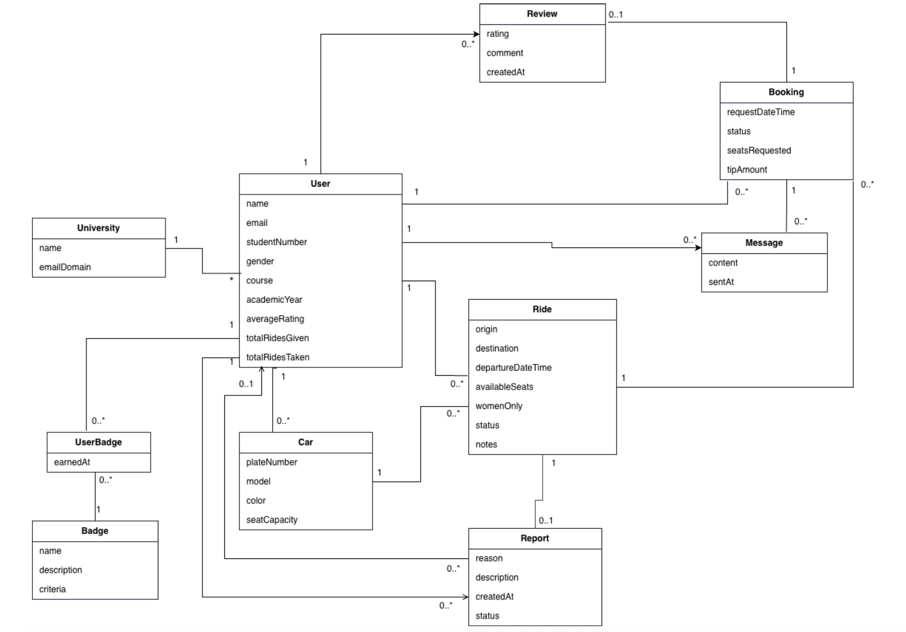
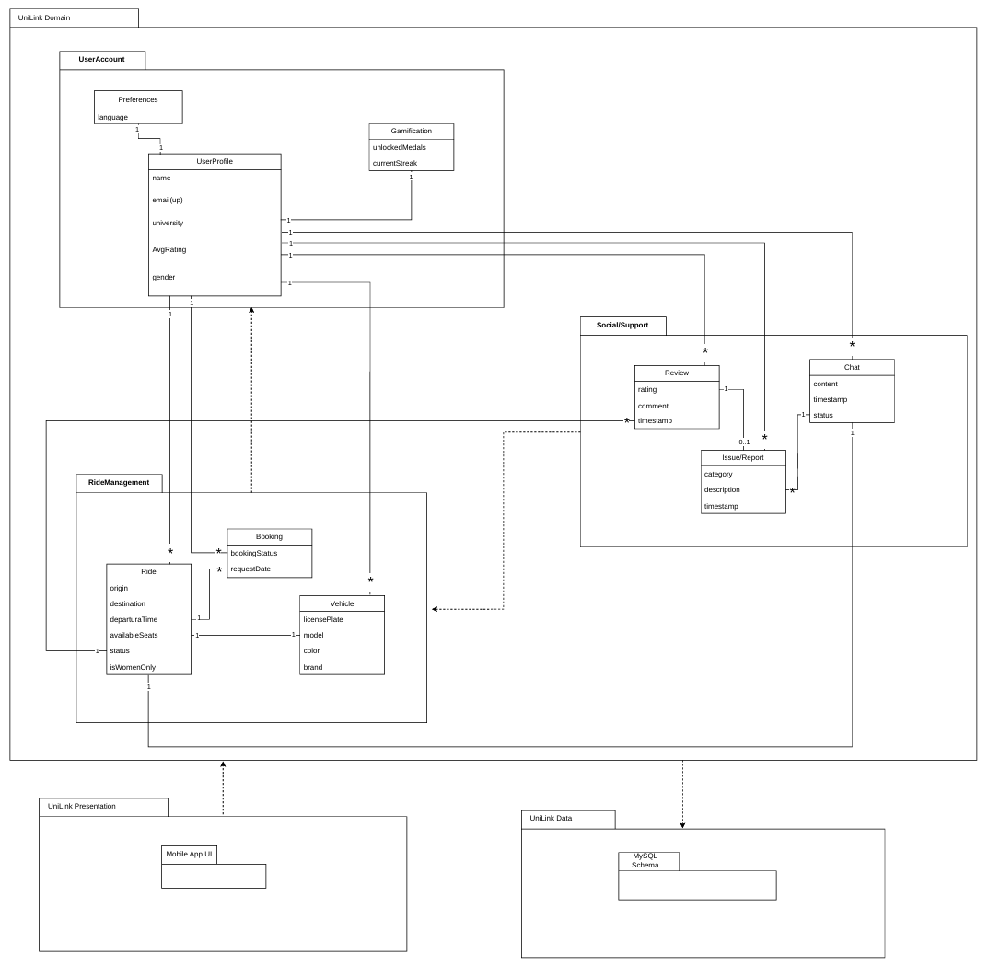
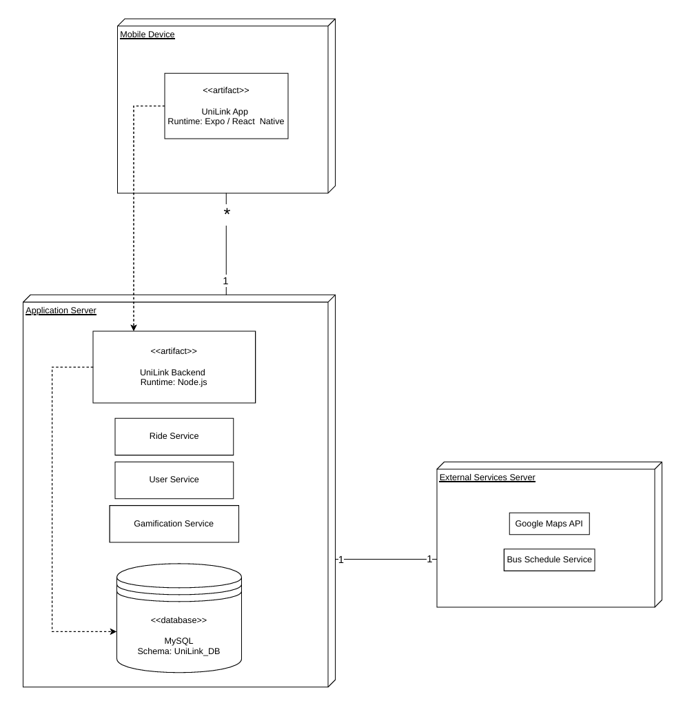

# UniLink Development Report

Welcome to the documentation pages of UniLink!

This Software Development Report, tailored for LEIC-ES-2025-26, provides comprehensive details about UniLink, from high-level vision to low-level implementation decisions. It’s organised by the following activities. 

* [Business modeling](#Business-Modelling) 
  * [Product Vision](#Product-Vision)
  * [Features and Assumptions](#Features-and-Assumptions)
  * [Elevator Pitch](#Elevator-pitch)
* [Requirements](#Requirements)
  * [User stories](#User-stories)
  * [Domain model](#Domain-model)
* [Architecture and Design](#Architecture-And-Design)
  * [Logical architecture](#Logical-Architecture)
  * [Physical architecture](#Physical-Architecture)
  * [Vertical prototype](#Vertical-Prototype)
* [Project management](#Project-Management)
  * [Sprint 0](#Sprint-0)
  * [Sprint 1](#Sprint-1)
  * [Sprint 2](#Sprint-2)
  * [Sprint 3](#Sprint-3)
  * [Sprint 4](#Sprint-4)
  * [Final Release](#Final-Release)
  

Contributions are expected to be made exclusively by the initial team, but we may open them to the community, after the course, in all areas and topics: requirements, technologies, development, experimentation, testing, etc.

Please contact us!

Thank you!

* António Machado up202404630@up.pt
* Diogo Caleiro up202407548@up.pt
* Gonçalo Queirós up202407377@up.pt
* José Lopes up202406360@up.pt
* José Silva up202406359@up.pt

---
## Business Modelling

Business modeling in software development involves defining the product's vision, understanding market needs, aligning features with user expectations, and setting the groundwork for strategic planning and execution.

### Product Vision

UniLink connects university students through safe, free and trusted ride-sharing, making academic mobility simpler, smarter and more social.

### Features and Assumptions

- Request and offer rides with vehicle identification (license plate and car model)
- Passengers can tip drivers
- Leaderboard system
- Only university students can register, using a university-associated email
- User profile including university, course, and academic year
- Average rating and reviews
- Badges (achievements earned as a passenger/driver)
- Google Maps integration
- Weekly streaks
- Bus schedules available when there are not enough rides
- Drivers display the number of rides given on their profile
- Schedule rides in advance
- Book/reserve rides
- Number of available seats
- "Women-only" ride option
- Messaging between driver and passenger
- Reporting system (user/ride reports)

### Elevator Pitch
<!-- 
Draft a small text to help you quickly introduce and describe your product in a short time (lift travel time ~90 seconds) and a few words (~800 characters), a technique usually known as elevator pitch.

Take a look at the following links to learn some techniques:
* [Crafting an Elevator Pitch](https://www.mindtools.com/pages/article/elevator-pitch.htm)
* [The Best Elevator Pitch Examples, Templates, and Tactics - A Guide to Writing an Unforgettable Elevator Speech, by strategypeak.com](https://strategypeak.com/elevator-pitch-examples/)
* [Top 7 Killer Elevator Pitch Examples, by toggl.com](https://blog.toggl.com/elevator-pitch-examples/)
-->

## Requirements

### User Stories
<!-- 
In this section, you should describe all kinds of requirements for your module: functional and non-functional requirements.

For LEIC-ES-2024-25, the requirements will be gathered and documented as user stories. 

Please add in this section a concise summary of all the user stories.

**User stories as GitHub Project Items**
The user stories themselves should be created and described as items in your GitHub Project with the label "user story". 

A user story is a description of a desired functionality told from the perspective of the user or customer. A starting template for the description of a user story is *As a < user role >, I want < goal > so that < reason >.*

Name the item with either the full user story or a shorter name. In the “comments” field, add relevant notes, mockup images, and acceptance test scenarios, linking to the acceptance test in Gherkin when available, and finally estimate value and effort.

**INVEST in good user stories**. 
You may add more details after, but the shorter and complete, the better. In order to decide if the user story is good, please follow the [INVEST guidelines](https://xp123.com/articles/invest-in-good-stories-and-smart-tasks/).

**User interface mockups**.
After the user story text, you should add a draft of the corresponding user interfaces, a simple mockup or draft, if applicable.

**Acceptance tests**.
For each user story you should write also the acceptance tests (textually in [Gherkin](https://cucumber.io/docs/gherkin/reference/)), i.e., a description of scenarios (situations) that will help to confirm that the system satisfies the requirements addressed by the user story.

**Value and effort**.
At the end, it is good to add a rough indication of the value of the user story to the customers (e.g. [MoSCoW](https://en.wikipedia.org/wiki/MoSCoW_method) method) and the team should add an estimation of the effort to implement it, for example, using points in a kind-of-a Fibonnacci scale (1,2,3,5,8,13,20,40, no idea).

-->

### Domain model

 

  

- **University**: Academic institution associated with users and responsible for validating restricted registration.
- **User**: Registered student who may act as driver, passenger or both.
- **Car**: Vehicle registered by a driver for ride sharing.
- **Ride**: Transportation offer created by a driver.
- **Booking**: Reservation made by a passenger for a specific ride.
- **Review**: Evaluation submitted after a completed ride.
- **Chat**: Communication exchanged between users in the context of a booking.
- **Badge**: Achievement that may be earned through platform activity.
- **UserBadge**: Association between a user and a badge earned.
- **Report**: Complaint submitted by a user regarding another user or a ride.

## Architecture and Design

The **UniLink** system is organized into distinct components to ensure that the user interface, the business logic, and the data storage are well-separated. This organization makes the system easier to develop, test, and maintain as the project grows.

To document our architecture, we decomposed the system into three main parts:

* **The Frontend:** A mobile application that handles all user interactions and displays information.
* **The Backend:** A central server that processes all the rules of the carpooling system, such as managing rides and user accounts.
* **The Persistence Layer:** Responsible for safely storing all the information generated by the users.

In the following sections, we describe how these components interrelate and the specific technologies used to implement each part of the system.

### Logical architecture

  

### Physical Architecture

  

The physical structure of the UniLink system is organized into three main hardware nodes:

* **Mobile Device (Node):** Represents the user's smartphone.
    * **UniLink App (Artifact):** The mobile application client developed with React Native/Expo.
* **Application Server (Node):** The central server responsible for the backend logic and data.
    * **UniLink Backend (Artifact):** The server-side application running on Node.js.
    * **Internal Services:** Logical modules for Ride, User, and Gamification management.
    * **MySQL (Database):** The relational database used for persistent data storage (Schema: UniLink_DB).
* **External Services Server (Node):** Third-party servers that provide additional functionality.
    * **Google Maps API:** Used for geolocation and route visualization.
    * **Bus Schedule Service:** Integration with external public transport data.

**Connections:**
* **Mobile Device <-> Application Server:** Standard internet connection for data exchange.
* **Application Server <-> External Services:** Data exchange through external APIs.

### Vertical prototype
<!--
To help on validating all the architectural, design and technological decisions made, we usually implement a vertical prototype, a thin vertical slice of the system integrating as much technologies we can.

In this subsection please describe which feature, or part of it, you have implemented, and how, together with a snapshot of the user interface, if applicable.

At this phase, instead of a complete user story, you can simply implement a small part of a feature that demonstrates thay you can use the technology, for example, show a screen with the app credits (name and authors).
-->

## Project management
<!--
Software project management is the art and science of planning and leading software projects, in which software projects are planned, implemented, monitored and controlled.

In the context of ESOF, we recommend each team to adopt a set of project management practices and tools capable of registering tasks, assigning tasks to team members, adding estimations to tasks, monitor tasks progress, and therefore being able to track their projects.

Common practices of managing agile software development with Scrum are: backlog management, release management, estimation, Sprint planning, Sprint development, acceptance tests, and Sprint retrospectives.

You can find below information and references related with the project management: 

* Backlog management: Product backlog and Sprint backlog in a [Github Projects board](https://github.com/orgs/FEUP-LEIC-ES-2023-24/projects/64);
* Release management: [v0](#), v1, v2, v3, ...;
* Sprint planning and retrospectives: 
  * plans: screenshots of Github Projects board at begin and end of each Sprint;
  * retrospectives: meeting notes in a document in the repository, addressing the following questions:
    * Did well: things we did well and should continue;
    * Do differently: things we should do differently and how;
    * Puzzles: things we don’t know yet if they are right or wrong… 
    * list of a few improvements to implement next Sprint;

-->

### Sprint 0

### Sprint 1

### Sprint 2

### Sprint 3

### Sprint 4

### Final Release
